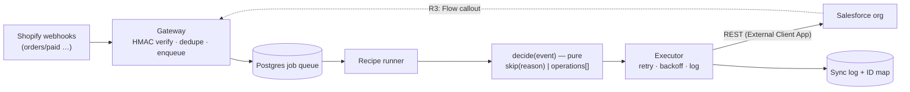

# Bridge Recipes — A Small Shopify → Salesforce Core, Shipped as Opinionated Recipes

> **Open-Source (MIT)** | Cross-platform: Shopify × Salesforce | Open for PRs & Discussions

> 📋 **Status: developer preview, not released.** Built and tested on a developer's machine: signed-webhook gateway, durable Postgres queue with retries and dead-letter replay, Salesforce client, executor with dry-run and a kill switch, sync log with retention, encrypted stored credentials, recipe R1, a single-operator admin page, and handlers for the Shopify privacy webhooks (`customers/data_request`, `customers/redact`, `shop/redact`) and `app/uninstalled`. R1 has been exercised against one Salesforce Developer org and one Shopify development store, including a real storefront order. It has **not** been deployed anywhere or reviewed by Shopify, of the privacy-webhook handlers only `app/uninstalled` has been verified with a real Shopify delivery (the three privacy topics are tested with signed requests; a real `customers/redact` or `shop/redact` has not been observed, and Shopify's CLI sample payloads cannot exercise them), and the deploy guide is a draft that has not been followed on a live host. Working name; Shopify's naming rules restrict "Shopify" in app names and URLs, so check the current requirement before choosing a listing name.


### Run it locally (developer preview)
Needs Node >= 22.23 and a Postgres. Variable **names** are in `.env.example`; values go in your untracked `.env`.
```
npm install
npm test                                   # database tests run when DATABASE_URL is set, otherwise they are skipped
node --env-file=.env scripts/admin.ts connect <shop>.myshopify.com   # store the Salesforce connection (secret encrypted)
node --env-file=.env scripts/admin.ts verify  <shop>.myshopify.com
node --env-file=.env scripts/admin.ts enable  <shop>.myshopify.com   # DRY-RUN: nothing is written; add --live to write
node --env-file=.env scripts/admin.ts status  <shop>.myshopify.com   # connection and recipe state
node --env-file=.env scripts/admin.ts disable <shop>.myshopify.com   # kill switch
npm start                                  # POST /webhooks/shopify, GET /healthz, GET /readyz, and /admin if ADMIN_PASSWORD is set
```
A recipe with no settings is disabled, and a newly enabled recipe is dry-run until you pass `--live`.

**Admin page (optional).** Set `ADMIN_PASSWORD` (at least 12 characters) and open `/admin` to connect Salesforce, test the connection, switch a recipe between dry-run, live and off, edit its settings, read the log and replay failed jobs, without the command line. It is a single-operator page behind a password, session cookie and CSRF protection; put it behind HTTPS in production. Leave `ADMIN_PASSWORD` unset and `/admin` does not exist. Limits: one shared password, no roles or two-factor, and the login limiter and logout list live in memory. It includes a **Compliance** page listing each privacy request and the Salesforce records to review.

**Configuration.** All settings are listed in `.env.example`. Notable: `TRUSTED_PROXY=true` only when a reverse proxy you control sits in front (it makes the login limiter count the real client address and marks the session cookie Secure); the `RETENTION_*` settings (defaults: sync log 30 days, webhook delivery records 14, order-to-Salesforce mapping 30, compliance log 365; the admin audit trail uses the sync-log window). Failed jobs are kept 14 days, so replay works within that window.

---

## 1. Overview & Vision

**The problem:** the big Shopify↔Salesforce connectors sync *everything* — every customer, every order — and flood the CRM. The cheap alternatives (Zapier-style tools) charge per task and still leave you to design the rules. What sales teams actually want is a **short list of useful signals** landing in Salesforce at the right moment, not a mirror of the store.

**The approach:** one tiny, boring, reliable **core** (verified webhooks, idempotency, a job queue with retries, Salesforce auth, an audit log) and a set of **recipes** on top. Each recipe is a narrow, opinionated rule with its own filters, shipped and reviewed on its own. The recipe collection grows over time; the core never becomes a sync engine.

**Trust features that are part of the product:** every recipe has a **dry-run mode** ("would create this Lead — nothing written"), a **kill switch**, and a **sync log with replay**.

---

## 2. Recipes (planned)

| # | Recipe | Trigger | Writes to Salesforce | Status |
|---|---|---|---|---|
| **R1** | **Retail-to-B2B Lead Spotter** | Shopify `orders/paid` | Lead (or a Task on an existing Account's owner) | 📋 First |
| **R2** | **VIP Threshold Alert** | Shopify `orders/paid` | Task for the account owner when lifetime spend or order count crosses a threshold | 📋 Second |
| **R3** | **Closed-Won → Shopify Draft Order** | Salesforce Opportunity closed-won | Shopify *draft order* (reserves stock properly) | 📋 Last (largest trust surface) |

### R1 — Retail-to-B2B Lead Spotter
A retail order from `@acme-corp.com` (not `@gmail.com`) is a possible bulk buyer.
- Skips free-email domains (shipped, editable blocklist), applies merchant allow/deny lists and a minimum order value.
- **Checks existing Salesforce first:** if the domain matches an existing Account, it creates a **Task for that account's owner** instead of a duplicate Lead; if the email already exists as a Lead, it updates or skips; if it exists as a Contact, it creates a Task for that Contact's owner.
- **Consent-aware by default:** only customers who accepted marketing, unless the merchant explicitly overrides (with a warning that the lawful basis is theirs).
- Lead description carries products and order total so the rep can pitch bulk pricing.
- **Duplicate rules are respected, never bypassed:** if a Salesforce duplicate rule blocks a Lead, the app logs `duplicate_detected` and does not override it. The "update" action appends to the Lead's description.

### R2 — VIP Threshold Alert
Crossing a merchant-set threshold (lifetime spend ≥ X **or** orders ≥ N) creates one Task for the right person — the owner of the matching Contact's Account, or a configured default owner. One alert per customer per threshold, ever.

### R3 — Closed-Won → Draft Order
When a wholesale Opportunity closes in Salesforce, create a **Shopify draft order** with the line items by SKU, tagged with the Opportunity id — never a raw inventory decrement. Needs a small Flow + Named Credential in the merchant's Salesforce org (sample provided).

---

## 3. The core (what every recipe shares)
- **Webhook gateway:** verifies the Shopify HMAC over the raw body, answers fast, enqueues work. Handlers for the privacy webhooks (`customers/data_request`, `customers/redact`, `shop/redact`) and `app/uninstalled` are implemented and tested with signed requests; the subscriptions themselves still have to be registered with Shopify (not yet documented). Redaction removes data from this service's database only: Leads and Tasks already written to your Salesforce org are your records, the app has no delete permission there by design, and the Compliance page lists their ids for you to review and delete.
- **Idempotency:** a delivery processed twice has the same effect as once (webhook-id and business-key dedupe).
- **Queue + retries:** Postgres-backed jobs, exponential backoff with jitter, dead-letter state, one-click replay.
- **Salesforce client:** External Client App, client-credentials flow (a Run As user), token caching, API-limit awareness.
- **Audit log:** recipe, topic, outcome, Salesforce record id, error class — with minimal personal data (emails masked in logs) and retention windows (see Configuration).
- **Safety:** per-recipe dry-run and kill switch.

---

## 4. Architecture & Tech Stack



**Stack (as built):** TypeScript on Node >= 22.23 with native type stripping (no build step) · `pg` and `pg-boss` on PostgreSQL · AES-256-GCM for stored Salesforce credentials · tests with `node --test`. A Shopify-embedded admin (Remix) is only a Phase B idea; the current admin is a plain server-rendered page.

```
core/            # gateway, queue, executor, worker, salesforce client, crypto, admin, compliance, app wiring
recipes/
└── retail-b2b-lead-spotter/   # R1: decide() is pure and unit-tested; JSON fixtures
db/migrations/   # SQL migrations 001-007
scripts/         # operator CLI (admin.ts) and one-off research/verification scripts
docs/            # SPEC, BUILD_PLAN, R1 contract, platform-fact research
```
R2 and R3 are planned; their directories do not exist yet.

---

## 5. Distribution
- **Phase A — self-host (start here).** A merchant runs their own copy of the service and installs their own copy of the Shopify app (their own client id and secret; the client secret is the service's `SHOPIFY_WEBHOOK_SECRET`). Shopify delivers webhooks to `https://<your-host>/webhooks/shopify`, and the service rejects any request whose signature does not match.
  - **Hosting:** the maintainer runs the project on Railway as a development example (not a hosted service for others): the health check is at `/healthz`, the admin page is password-protected, and Shopify's webhooks go to `https://<your-host>/webhooks/shopify`. One real signed `app/uninstalled` delivery from the development store was received and recorded there on 2026-10-26; `orders/paid` and the full end-to-end flow have not been verified on that instance. The deploy guide, [`docs/DEPLOY_RAILWAY.md`](docs/DEPLOY_RAILWAY.md), is a draft that has not been followed end to end by anyone else.
  - **Distribution of the development app is Public.** It was created that way in the Shopify Dev Dashboard (Shopify does not let that be changed afterwards), so it follows Shopify's public-app rules. **Protected customer data approval is a separate Shopify step:** for the development app the request for names and emails is a saved draft that has not been submitted or approved.
  - A self-hosting merchant can instead create their own app with **custom distribution** for a single store; Shopify's docs list level 2 protected customer data (name, email) as "always available" for custom apps (and "varies by plan" for admin-created ones). Check the current requirements for your plan and distribution before relying on this.
- **Phase B — Shopify App Store listing**, only after R1 is proven with real stores. Requires a protected-customer-data request (level 2: name and email) and possible data protection review.

---

## 6. Permissions (minimum per recipe)

| Recipe | Shopify scopes | Salesforce access |
|---|---|---|
| R1 | `read_orders` (customer name and email come with the order and need protected customer data access, level 2; whether `read_customers` is needed at all is being re-checked) | API Enabled · Lead create/read/update · Account read (`Website`, `OwnerId`) · Contact read (`Email`, `AccountId`, `OwnerId`) · Task create and edit, with field access to Task `Description`, `WhatId`, `WhoId`. Verified in a Developer org: the integration user needs a full Salesforce licence, not the Salesforce Integration licence, to create Tasks. |
| R2 | `read_orders`, `read_customers` | Task create · Contact read |
| R3 | `write_draft_orders`, `read_products` | Flow + Named Credential in the merchant's org |

Only the scopes for *enabled* recipes should be requested; a bigger scope later must be justified and signed off first.

---

## 7. Market Position
Connectors exist (Salesforce's own commerce tooling, iPaaS vendors, paid Shopify→Salesforce syncs). The gap is *opinion*: filtered, explainable signals with a safe preview, open source, and no per-task fees. Honest caveat: protected-data review and CRM privacy law (consent) make R1 the riskiest recipe to publish widely — hence self-host first.

---

## 8. Open-Source Roadmap & Good First Issues
- [x] Core: HMAC verify, dedupe, queue, retries, sync log, kill switch _(built and tested locally; not deployed)_
- [x] Salesforce client against a Developer org (External Client App) _(client credentials; exercised against one Developer org)_
- [x] R1 with dry-run, existing-account check and consent filter _(exercised in one Developer org and one dev store with real storefront orders: marketing box ticked creates a Lead and a repeat buyer updates it, unticked is skipped)_
- [x] Admin UI: connection, recipe settings, log with replay
- [x] Privacy-webhook handlers with real redaction _(tested with signed requests; `app/uninstalled` verified with a real Shopify delivery; a real `customers/redact` or `shop/redact` has not been observed)_
- [ ] Self-host guide (Railway) + custom-app install guide
- [ ] R2 VIP Threshold Alert
- [ ] R3 Closed-Won → Draft Order + sample Flow
- [ ] Good first issue: expand the free-email domain blocklist and add tests
- [ ] Good first issue: multi-currency threshold normalisation for R2
- [ ] Good first issue: B2B company → Salesforce Account mapping
